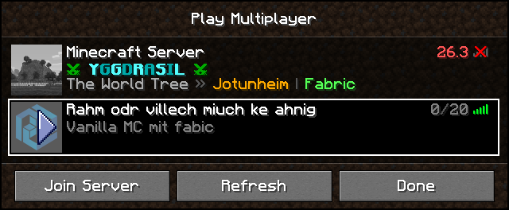
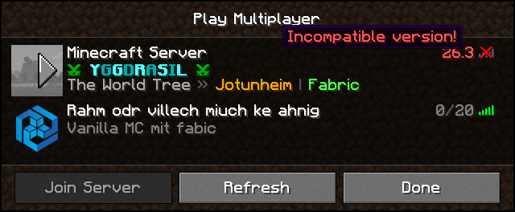
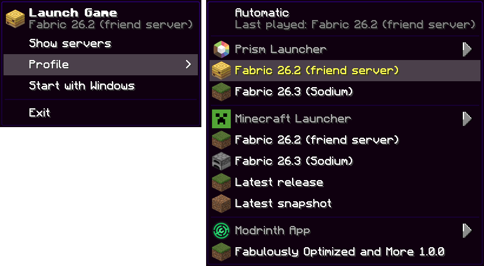

# McServerTray

A small Windows tray app that watches your saved Minecraft servers and tells you when someone
comes online, with a server list that looks like the game's own *Multiplayer* screen.



## Install

Grab the latest release from the [releases page](https://github.com/Nachtalb/mc-server-tray/releases):

- **`McServerTray-x.y.z-setup.exe`** installs for your user (no admin), adds a Start menu entry and
  can start with Windows. If the [.NET 9 Desktop Runtime](https://dotnet.microsoft.com/download/dotnet/9.0)
  is missing, it downloads and installs it from Microsoft first.
- **`McServerTray-x.y.z-portable.zip`**: unzip and run `McServerTray.exe`. Needs the .NET 9
  Desktop Runtime; Windows offers to download it if it isn't installed.

## Features

- **Notifications** when someone joins one of your servers: "Steve is online", with the server's
  icon and a *Join Server* button. Servers that hide their player list are reported by count.
- **Server list** on a left click of the tray icon, drawn with the game's font, sprites and your
  active resource packs: server icon, your name for it, the coloured MOTD, player count and ping
  bars. Hover the count for who's online, the bars for latency and version. Servers on another
  game version are flagged as incompatible, like in the game.
- **Join** a server from the list (play arrow, double-click or *Join Server*); the profile starts
  straight into it through Prism Launcher.
- **Profiles** from Prism Launcher, the official Minecraft Launcher and the Modrinth App. Pick the
  one to watch in the tray menu, or leave it on *Automatic* (the one played last). Its servers,
  game version and resource packs are used; changes to the packs show up the next time you open the list.
- **Tray menu** in the same style: *Launch Game*, the profile picker (each launcher's heading opens
  that launcher) and *Start with Windows*.





## Minecraft look

Nothing from Mojang is shipped with the app. It reads the font, GUI sprites, sounds and textures
from the game files your launcher has already downloaded (the client jar of the profile's version
and its enabled resource packs). Without them it falls back to plain Windows drawing. The app and
installer icons are original artwork (`tools/make-icon.ps1`, `tools/make-installer-art.ps1`).

## Build

Requires the .NET 9 SDK.

```powershell
dotnet publish -c Release -o publish
.\publish\McServerTray.exe
```

The installer is built with [Inno Setup 6](https://jrsoftware.org/isinfo.php):

```powershell
dotnet publish -c Release -o publish -p:DebugType=none
iscc /DAppVersion=1.0.0 /DPublishDir=..\publish installer\McServerTray.iss
```

Pushing a `v*` tag builds both downloads and publishes a GitHub release.

## License

[MIT](LICENSE)
